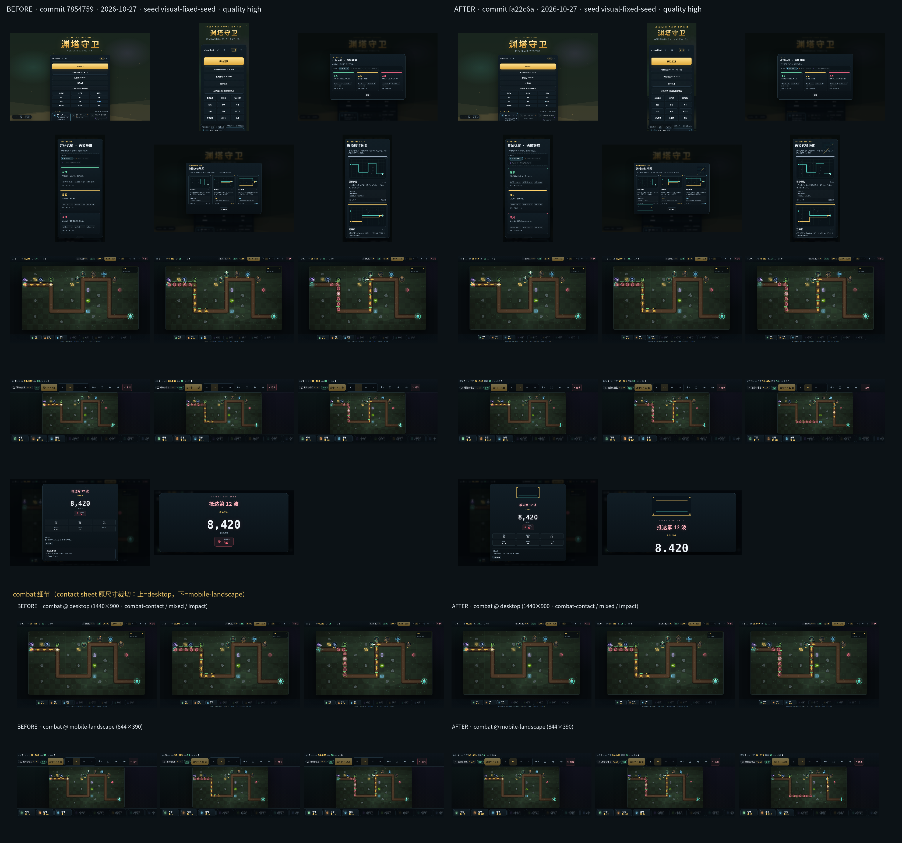

# 打击感评审记录（FEEL_REVIEW）

GOAL-005「战斗反馈 2.0：每一击都有重量」的**语义层**证据。机械层由
`scripts/visual-check.mjs --suite feel` 独立判定；本文件只记录「人（或全新上下文的评审 agent）看图之后的结论」。

两层互不替代：

| 层次 | 入口 | 回答的问题 |
| --- | --- | --- |
| 机械 | `node scripts/visual-check.mjs --suite feel` | 反馈覆盖、命中特效覆盖、飘字可见性、敌我反差、特效预算是否达标 |
| 语义 | `node scripts/feel-review.mjs --check` | 同一批图是否被真正看过，并且结论是「通过」 |

## 如何产出评审记录

1. 采集前后对照图：
   ```bash
   npm run visual:capture -- --scene combat --quality high --out /tmp/feel-before
   ```
   改动后再采一次，把两次目录都保留（`contact-sheet.html` 可直接在浏览器里并排看）。
2. 逐帧看 `contact-sheet.html`：命中闪白、飘字、击杀迸发、漏怪/清波/首领演出是否读得出来。
3. 在本文件「评审记录」下按下面的格式追加条目；`场景` 至少要覆盖 `combat`。
4. 跑 `node scripts/feel-review.mjs --check`，exit 0 才算记录成立。

## 条目格式

```markdown
### FEEL-001 · combat 前后对照
- 场景：combat
- 日期：2026-10-27
- 评审者：fresh-context-reviewer
- 对照：before=/tmp/feel-before after=/tmp/feel-after
- 结论：通过
- 分数：8/10
- 说明：命中闪白与火花可辨识，暴击与普通命中分层清楚；混战时飘字不刷屏。
```

必填字段：`场景`、`日期`、`评审者`、`结论`、`分数`。`结论` 必须是「通过」；`分数` 形如 `8/10`。

## 基线（VIS-001 采集）

- 采集入口：`tests/visual-scenes.mjs`（固定种子、固定 1/60 步长、桌面 1440×900 / 移动横屏 844×390）。
- 首轮基线对照图：`docs/reviews/baseline-contact-sheet.png`，配套指纹见 `docs/reviews/baseline-manifest.json`
  （14 帧 = 5 场景 × 两视口，战斗场景各 3 帧）。
- 基线机械结果（2026-10-27，`--quality high`）：
  - 反馈覆盖 0.0024（阈值 ≥ 0.002）
  - 命中特效覆盖 0.0006（阈值 ≥ 0.0003）
  - 受击闪白覆盖 0.0016、飘字覆盖 0.0004、敌人与背景 ΔE 18.2
  - 单场景采集耗时约 3.2–3.8 秒，全场景全视口约 31 秒（远低于 60 秒 / 5 分钟预算）。
- 语义评审：见下方「评审记录」（FEEL-001，2026-10-28，**不通过 4/10**）。

## 评审过程

- 采集日期：2026-10-27（before 22:10、after 21:15，均为 CST）。
- **after 侧**：commit `fa22c6a`（任务分支 tip），全场景 × 两视口，`quality high`：
  ```bash
  node tests/visual-scenes.mjs --scene all --quality high --out /tmp/feel-after-capture
  ```
- **before 侧**：commit `3b8e1fd`（develop 上第一个包含确定性采集基建的提交，早于全部打击感改动），在临时 worktree 内重采 combat 两视口，`quality high`：
  ```bash
  git -C /tmp/feel-before-wt checkout -q 3b8e1fd
  cd /tmp/feel-before-wt && node tests/visual-scenes.mjs --scene combat --quality high --out /tmp/feel-before-frames
  ```
  全景对照的左半来自 VIS-001 的基线采集 `docs/reviews/baseline-contact-sheet.png`（其 manifest 记录的采集基线为 `7854759`，是 `3b8e1fd` 的父提交）；combat 细节对照用的是 `3b8e1fd` 重采帧。
- 视口：desktop 1440×900；combat/result 另用 mobile-landscape 844×390；title/lobby/map 另用 mobile 390×844。
- 种子：`visual-fixed-seed`（模拟）/ `visual-scene-seed`（场景）。帧指纹见两份 `manifest.json`。
- 合成：`ffmpeg` hstack 生成 `feel-review-before-after.png`（左 before / 右 after，两半都带 commit 与日期标签），再 vstack 拼上 combat 两视口的原尺寸裁切。
- **起始读数（记录一开始不存在）**，2026-10-27 在任务 worktree 内实测：
  ```text
  $ node scripts/feel-review.mjs --check
  打击感评审 · docs/FEEL_REVIEW.md

  问题：
    - 缺少评审条目（需要至少一条 `### 标题` + 场景 / 日期 / 评审者 / 结论 / 分数 的记录）
    - 评审记录未覆盖场景：combat

  结论：未通过
  EXIT=1
  ```
- **机械层同时读数**（2026-10-28 复跑，`node scripts/visual-check.mjs --suite feel`，`--quality high`）：PASS —— 反馈覆盖 0.0023（≥0.002）、命中特效覆盖 0.0006（≥0.0003）、受击闪白 0.0016（≥0.0004）、飘字覆盖 0.0003（≥0.00008）、飘字条数 2（≥1）、同屏命中特效 7（≥4）、敌人与背景 ΔE 17.09（≥10）、特效预算 7（≤320）。机械层只证明「反馈层存在且达标」，不证明「看起来有重量」，两者必须同时成立。
- **评审者与上下文隔离**：全新上下文 subagent `ac6c9e7b5c403f466`（general-purpose）。它只收到 6 张对照图、GOAL-005 退出条件原文与逐项问题清单；prompt 明确禁止读取仓库源码/任务/目标/记忆、禁止运行会读取仓库的命令；它看不到本任务的实现过程、提交历史与预期结论。执行者只原样转写其输出。
- **前一位评审者**：`a339ae263dada12dd` 在 2026-10-27 23:44 被外部 `quay driver drain --kind worker` 连带终止（exit 143），未产出结论，故重开评审；其已完成的裁切图仅留在 `/tmp`，未用于本次结论。
- **本次证据边界（必须如实记录）**：评审者只纳入了图 1/2/3/5（combat 桌面三帧 + 放大裁切）；图 4（combat@mobile-landscape）与图 6（五场景全景）因评审被要求收束而**未纳入**。此外 after 的移动端采集存在时间漂移（combat-impact 实际采到 t=12s、combat-mixed 实际采到 t=8s，而请求的是 8s/4.5s），移动帧因此不可作为同 t 对照——见「执行者核对」。
- 对照图：`docs/reviews/feel-review-before-after.png`（3352×3132，含全景并排 + combat 细节）。

## 评审记录

### FEEL-001 · combat 桌面三帧前后对照（不通过）

- 场景：combat
- 视口：desktop
- 日期：2026-10-28
- 评审者：fresh-context-subagent-ac6c9e7b5c403f466
- 对照：before=3b8e1fd after=fa22c6a（seed visual-fixed-seed，quality high）
- 结论：不通过
- 分数：4/10
- 说明：受击闪白重绘 + 飘字合并/变暗 + 伤害数字变化是唯一可确认的改动；飘字对比度下降、锐利命中星芒被整身刷白取代；八武器区分、暴击/击杀/首领/破盾、飘字三档、漏怪/清波/首领死亡、reduced-motion、自动画质在所提供的静态帧里均无可判定证据。



评审者原始输出（原样转写，未改写结论、未调整分数）：

```text
A. 逐项判断

1. 命中可辨识（可见）— 依据：图 5（combat-impact 原尺寸裁切）纵向车道第 3 只粉色敌人、图 3（contact t=2s）拐角处金色敌人。BEFORE 是「锐利白色六芒星火花 + 柔和粉色径向光晕」；AFTER 星芒几何消失，变成「整身刷白/去饱和 + 粉晕」，闪白面积更大但敌人轮廓被糊掉。结论：两版都有可见命中反馈层，但反馈形态被替换，AFTER 丢失了锐利切分感。静态帧看不到受击位移与顿帧（敌人坐标、血条与 BEFORE 完全一致）。

2. 八种武器是否可区分（部分可见）— 依据：三帧底部塔栏只有 弩塔/炮塔/霜塔 3 格解锁，其余 5 格为「未解锁」；画面中仅识别出两类命中效果家族：粉色/白色径向光晕（普通敌人）与金色圆环 + 青色弧旋 + 小白火花（contact 最左侧敌人）。绿色/白色长条为弹体。能分辨的至多 2 类，且无法把效果映射到具体武器；八种武器的可区分性在本组场景里根本没有被激励到。

3. 暴击/击杀/首领命中/破盾独立反馈层（静态图不可判）— 依据：三帧内 击杀 0、无首领单位、血条均为普通绿色无破盾层；所有飘字为同款灰/白数字，无暴击样式、无「破盾」「护甲」标识，也没有额外的暴击/首领反馈图形。

4. 击杀独立演出（静态图不可判）— 依据：三帧击杀计数均为 0，无敌人消失帧、无金币迸发、无碎裂/残影；路面上的两团金色尘迹在 BEFORE/AFTER 位置完全一致，不是新增演出。

5. 伤害飘字分层与可读性（部分可见）— 依据：contact 帧左侧三个「20」、impact 帧右上角数字。可确认全部为单一样式的普通数字，没有任何颜色/描边/字号分层，破盾/护甲/治疗从未出现；「全部/仅关键/关闭」只能看到一档（默认档），另两档不可判。可读性上 AFTER 反而退步：contact/mixed 帧 AFTER 的「20」由近白降为明显偏灰，混战中对比度更低；impact 帧 BEFORE 呈现上下叠印的两组「30」（重叠难读），AFTER 是单个更大更干净的数字——但数值也不同（30 vs 68），在 金币/波次/基地/击杀 完全一致的前提下，这一点与「同 seed 结果一致」相矛盾，需用伤害事件日志解释。

6. 漏怪/清波/首领死亡演出（静态图不可判）— 依据：三帧 基地 30/30 无掉血、无红色蒙版/基地脉冲痕迹；无清波横幅、无慢动作可辨痕迹（静态单帧无法证明时长变化）；无首领。且这三类本质上是时序演出，单帧证据力不足。

7. reduced-motion / 关闭震屏（静态图不可判）— 依据：静态图无法分离「运动层」与「非运动层」。只能观察到 AFTER 的受击改用颜色刷白这类非运动表达，理论上关震屏后应仍可见，但这只是推测，不能据此判定实现是否正确处理 reduced-motion。

8. 默认画质与「任何档位完整反馈链」（静态图不可判）— 依据：图头明确 quality high，三帧全部为高画质；没有任何「自动档 / 低/弱机档」帧，也没有首次进入的档位标识，无法判断降档后反馈链是否完整、30fps 是否仅为显式选择。移动端对照（图 4）与总 contact sheet（图 6）未纳入本次证据基础，移动端结论同样缺失。

9. 整体重量感（部分可见，提升不可确认）— 依据：可见变化仅两处：受击从锐利星芒改为整身刷白（impact 图右上与车道、contact 图拐角），impact 帧的伤害数字更干净更大。反向证据：敌人位置/血条无击退位移，无冲击波、无屏幕位移痕迹（静态不可判），飘字在 contact/mixed 变暗变灰，刷白把敌人剪影洗掉降低了命中轮廓的可读性。综合看：没有可辨识的整体重量感提升，局部（飘字对比度、剪影可读性）倒退。

B. 结论：不通过。现有对照唯一可确认的改动是受击闪白重绘与飘字样式/数值变化，其中飘字对比度明显下降、锐利命中星芒被整身刷白取代；同 seed 下飘字出现 30/30 vs 68 的数值与条数不一致；而退出条件中的绝大多数（八武器区分、暴击/击杀/首领/破盾、飘字三档、漏怪/清波/首领死亡、reduced-motion、自动画质降档）在提供的静态帧里没有可判定证据。

C. 分数：4/10

D. 扣分理由
- 【阻塞】伤害飘字对比度在 AFTER 下降：contact/mixed 帧「20」由近白变灰，混战中更难读，与退出条件「对比度」相悖。
- 【阻塞】同 seed 同 t 下飘字显示 BEFORE 两个「30」、AFTER 单个「68」，数值与条数都不一致；若为伤害值则与「同 seed 模拟逐字节一致」冲突，须以事件日志解释后重判。
- 【阻塞】八种武器命中区分无任何可判定证据：场景仅 3 塔解锁，画面最多 2 类效果家族，无法验收「八种武器都有可区分命中音效与特效」。
- 【阻塞】暴击/击杀/首领命中/破盾的独立反馈层：帧内 击杀 0、无首领、无破盾、飘字无样式分层，四项全部无证据。
- 【阻塞】飘字「全部/仅关键/关闭」三档、漏怪/清波/首领死亡演出、reduced-motion 下的非运动反馈、默认自动档与低画质完整性：均无对应帧，退出条件无法验收。
- 【非阻塞】命中星芒被整身刷白取代：闪白面积变大，但锐利切分感与敌人剪影辨识下降（风格取舍，但当前观感是糊化）。
- 【非阻塞】受击敌人无可见位移：坐标与血条位置与 BEFORE 完全一致，丢失了最廉价的重量线索（静态单帧只是弱证据，需视频确认）。
- 【非阻塞】本次证据缺移动视口与全场景对照（评审中止前未纳入图 4/6），移动端与跨场景一致性未评。

E. 静态图不可判的项与所需证据
1. 八武器可区分 → 需 8 种塔分别开火的固定 seed 帧序列或录制视频，并附 8 段可区分命中音效的音频验收。
2. 暴击/击杀/首领命中/破盾独立层 → 需触发这些事件前后的帧序列 + 结构化命中事件日志（事件类型、反馈层、并发限流、粒子预算字段）。
3. 击杀独立演出 → 需击杀瞬间及之后 0–500ms 的帧序列或视频。
4. 飘字三档 → 需「全部/仅关键/关闭」三档、同 seed 同 t 的同帧截图各一张。
5. 漏怪/清波/首领死亡演出 → 需对应事件触发的帧序列或录制视频（横幅/慢动作/红屏）。
6. reduced-motion / 关闭震屏 → 需同一事件在开关两种设置下的帧序列对比，证明非运动层保留。
7. 默认画质自动档 → 需首次进入（无本地存储）时的档位标识（桌面/移动各一）+ 低画质同 seed 帧证明反馈链完整 + 30fps 仅显式选择的 UI 证据。
8. 同 seed 逐字节一致 → 需伤害事件日志与 RNG 调用序列 diff（对应本次飘字 30/30 vs 68 的疑点）。
9. 性能与机械指标 → 需 `npm run perf:budget` 输出、反馈覆盖/对比度/特效预算的机械指标报告。
10. 命中音效 → 需音频文件或带声轨的录制视频（本评审无音频输入）。
11. 评审记录落盘 → 需 `docs/FEEL_REVIEW.md` 的存在与内容摘录（隔离纪律下我未读仓库）。
```

## 执行者核对（不改变评审结论）

以下是执行者在落记录时对评审者可核对项做的独立核对，**只补充事实，不修改上面的结论与分数**：

- **飘字 30/30 → 68 不是模拟分叉**。after 引入了飘字合并层：`public/js/shared/floaters.js:119` 的 `mergeFloaterText` 对同层、半径 `MERGE_RADIUS`、时间窗 `MERGE_WINDOW` 内的数字文案**求和**；`public/js/shared/floaters.js:143` 的 `pushFloater` 在入列前合并，所以两条相邻的 30 会变成一条 68，飘字条数也从 3 变 2。桌面 combat 三帧的 `manifest.snapshot` 在 t=8s 时 `enemies=13` 与 before 一致，差异只有 `floaters` 条数（3→2）与 1px 画布偏移；未发现模拟结果分叉的直接证据。更严格的结论仍应以伤害事件日志 + RNG 调用序列 diff 为准（对应评审者 E.8），本记录不据此把 30/68 判为已澄清。
- **移动端 after 采集不可用作同 t 对照**：after 的 `combat@mobile-landscape` 三帧实际模拟时间为 t=12s / 8s / 8s（请求 8s / 4.5s / 2s），before 侧为正确的 8s / 4.5s / 2s。这是采集时间漂移，不是画面结论；移动端因此未被评审者纳入，也不应被当作「移动端通过/不通过」的证据。
- **帧指纹**：combat 的 6 个（场景×视口×帧）指纹在 before/after 之间全部不同，确认对照图不是同一张图复制。
- **机械层与语义层的分歧**：`visual-check --suite feel` 全项 PASS，但语义评审判不通过——这不是矛盾，机械层回答「反馈层是否存在且达到数值阈值」，语义层回答「看起来有没有重量」。两者必须同时成立，当前语义层未成立。

## GOAL-005 退出条件逐条判断

| # | 退出条件 | 判断 | 依据 / 归属 |
| --- | --- | --- | --- |
| 1 | 首次进入默认自动档；任何档位下完整命中反馈链可见 | **不可见（未验收）** | 本次对照全部为 `quality high`；自动档/low 画质无帧。需按 E.7 补首次进入与低画质帧。机械指标 ≠ 画质降档完整性。 |
| 2 | 每次伤害产出结构化命中事件；同 seed 模拟与 RNG 逐字节一致 | **不可见（需日志）** | 静态图不能证明；30/68 疑点已由飘字合并解释，但仍需伤害事件日志 + RNG diff 定论（E.8）。机械层由 `scripts/visual-check.mjs --suite feel` 与 AC-012 的事件测试覆盖。 |
| 3 | 八种武器音效/特效可区分；暴击/击杀/首领/破盾独立层 | **不可见（未验收）** | 场景只有 3 塔解锁、最多 2 类效果家族；暴击/击杀/首领/破盾无触发帧。需 E.1/E.2 的事件触发帧与音频验收。 |
| 4 | 飘字「全部/仅关键/关闭」三档；破盾/护甲/治疗可辨识 | **部分可见** | 只见默认档单一样式；三档与破盾/护甲/治疗层无证据（E.4）。AFTER 对比度下降为阻塞项。 |
| 5 | 漏怪/清波/首领死亡独立演出；reduced-motion 仍有非运动反馈 | **不可见（未验收）** | 三帧内无漏怪/清波/首领事件；reduced-motion 无开关对比帧（E.5/E.6）。 |
| 6 | 性能预算不回归；战斗场景机械指标通过 | **可见（机械层）** | `visual-check --suite feel` 全项 PASS（反馈覆盖 0.0023、特效预算 7/320 等）；`npm run perf:budget` 属于独立机械见证，不在语义评审范围。 |
| 7 | 评审记录写入 `docs/FEEL_REVIEW.md` | **本文件** | 一条不通过条目，按任务约定保持不通过、不靠改记录通过。 |

## 立案

不通过项已立案：`gap-feel-evidence-and-regressions`（todo）——补齐事件触发证据（八武器、暴击/击杀/首领/破盾、飘字三档、漏怪/清波/首领死亡、reduced-motion、自动档与低画质、移动视口），修复飘字对比度与命中剪影可读性，修正采集时间漂移断言，然后重新做一次全新上下文语义评审。

在整改任务落地并复评通过之前，AC-020 不成立，GOAL-005 不关闭。
